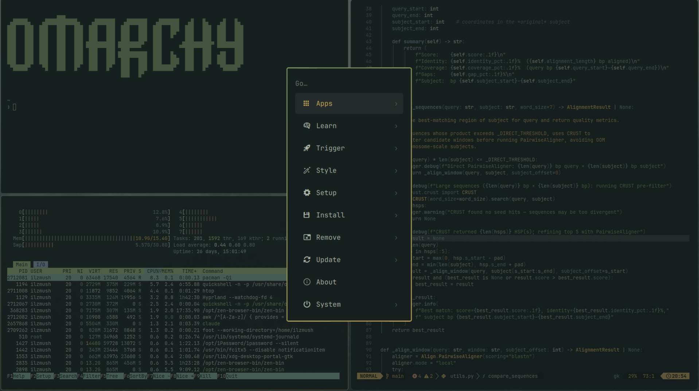

# Säule

Fog, moss and candle-ochre over a dark forest. A dark theme for [Omarchy](https://omarchy.org).

Inspired by "Rundtgåing av den transcendentale egenhetens støtte" ("Rundgang um die transzendentale Säule der Singularität") by Burzum



## Install

Open the Omarchy menu (`Super + Alt + Space`), go to **Install → Style → Theme**, and paste:

```
https://github.com/ElijahL/omarchy-saule-theme
```

Or from a terminal:

```sh
omarchy-theme-install https://github.com/ElijahL/omarchy-saule-theme
```

## Palette

| Role       | Color     | Role           | Color     |
|------------|-----------|----------------|-----------|
| background | `#181f1f` | foreground     | `#abb4a7` |
| accent     | `#c9a95c` | selection      | `#303b39` |
| red        | `#bd7c68` | bright red     | `#cd9482` |
| green      | `#84a06b` | bright green   | `#a5bc83` |
| yellow     | `#c9a95c` | bright yellow  | `#e0c886` |
| orange     | `#b98552` | brown          | `#5f4e35` |
| blue       | `#7a95a0` | bright blue    | `#9ab2b8` |
| cyan       | `#749a8b` | bright cyan    | `#96b7a8` |
| magenta    | `#9e8ea0` | bright magenta | `#b6a6b5` |

Icons: Yaru-sage.

## Wallpapers

- `1-fog-forest.jpg` comes from the wallpapers that ship with Omarchy.
- `2-ruhe-nach-dem-sturm.jpg` is Erik Bodom's *Ruhe nach dem Sturm* (1871), which is in the public domain.

The wallpapers stay under their original authors' terms. If you own one of these images and want it credited or removed, please open an issue.

## License

The theme configuration is MIT licensed. See [LICENSE](LICENSE).
